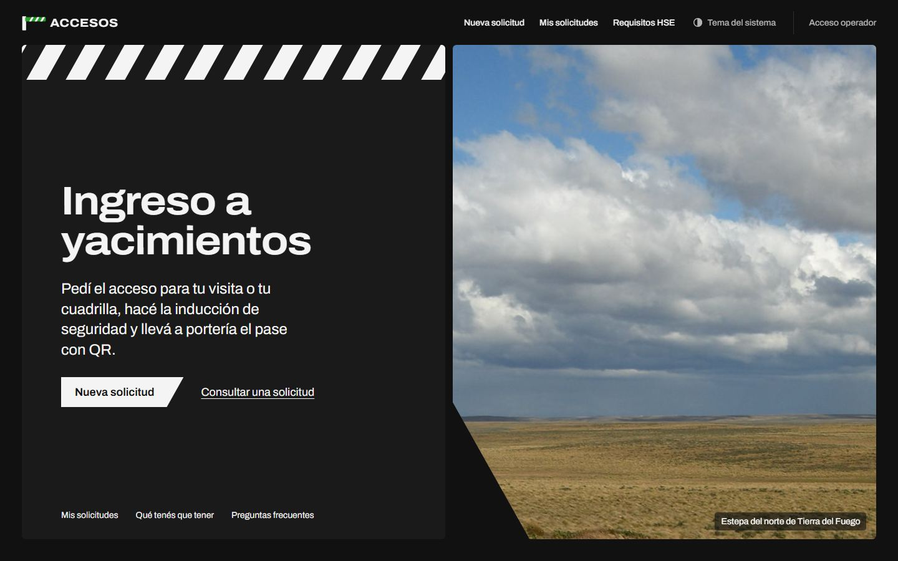
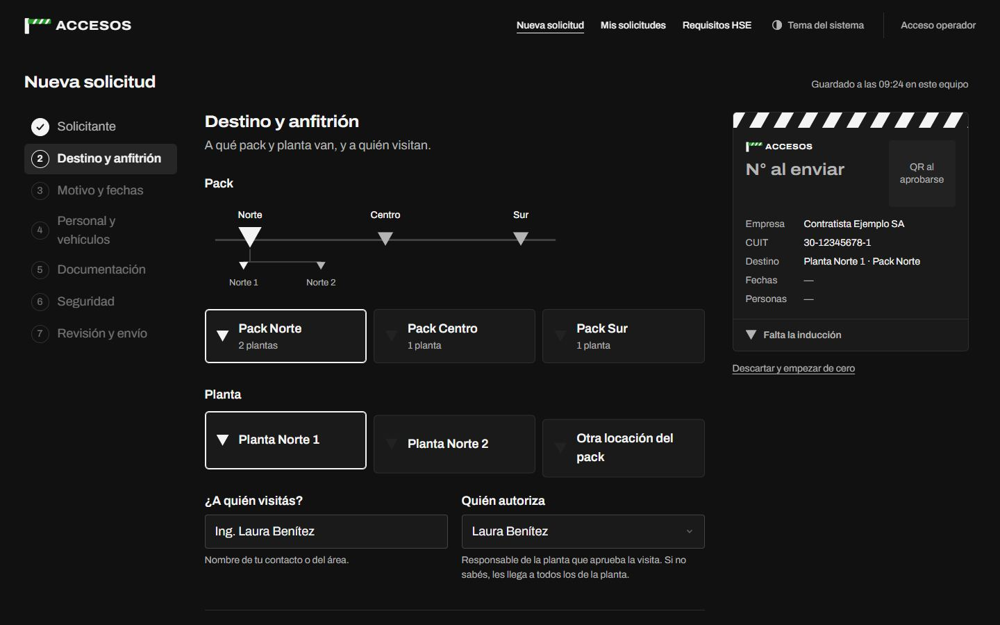
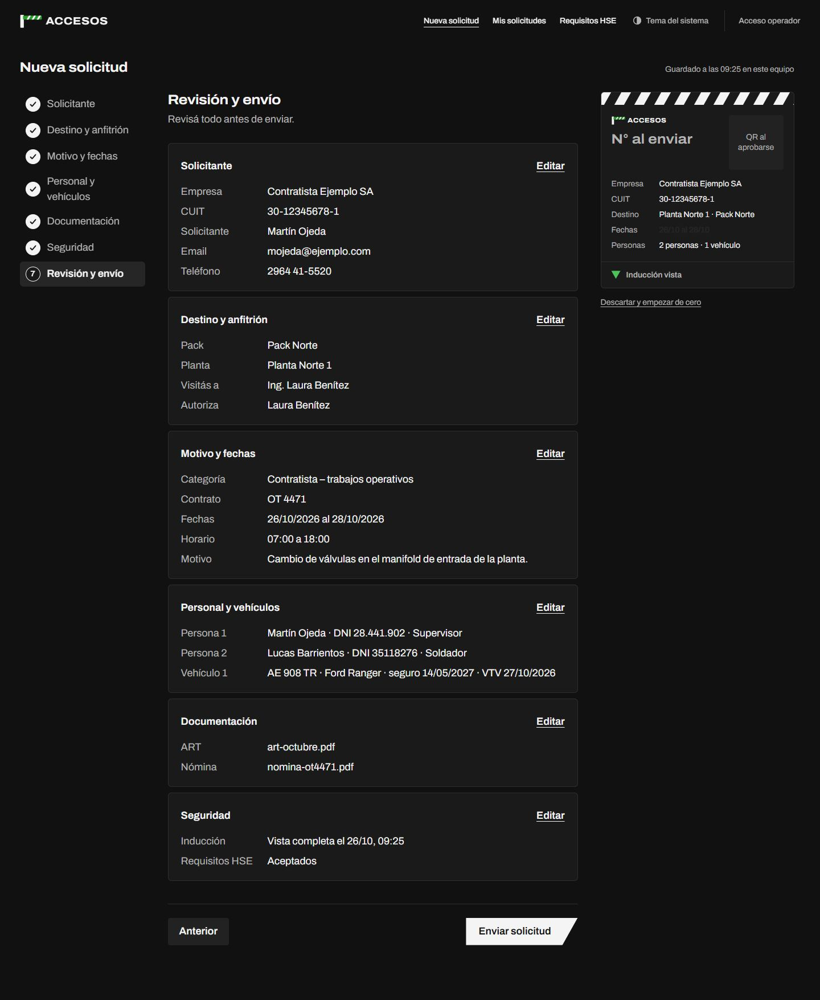
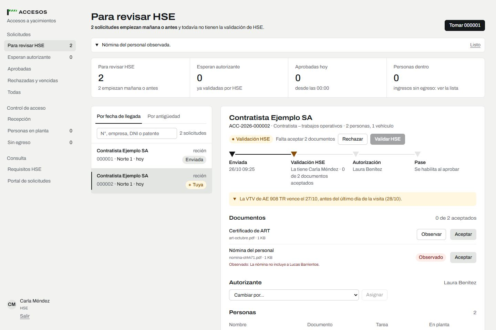
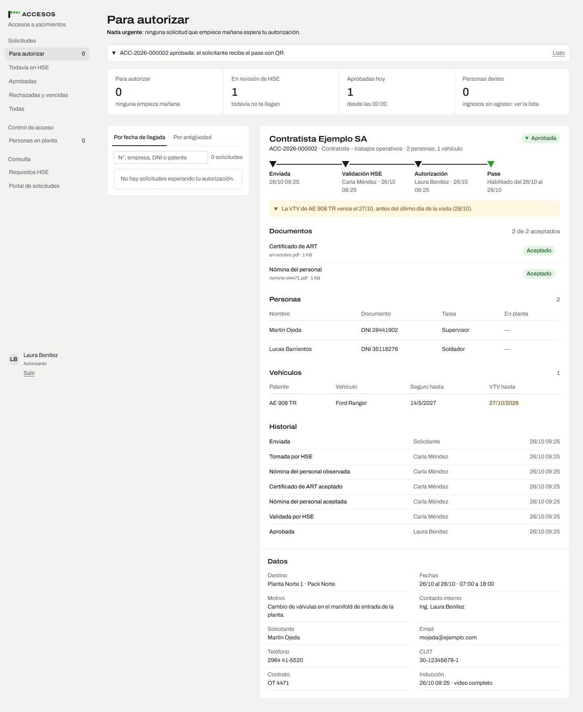
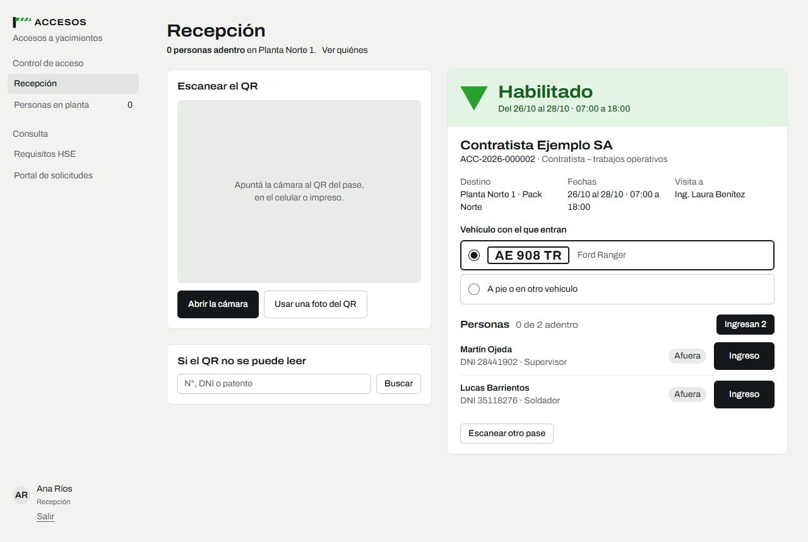
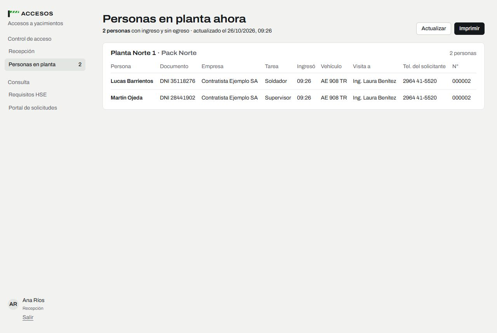
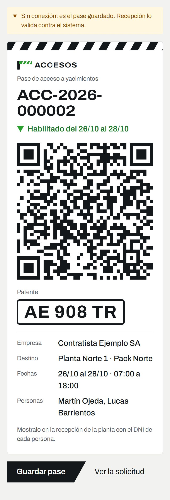
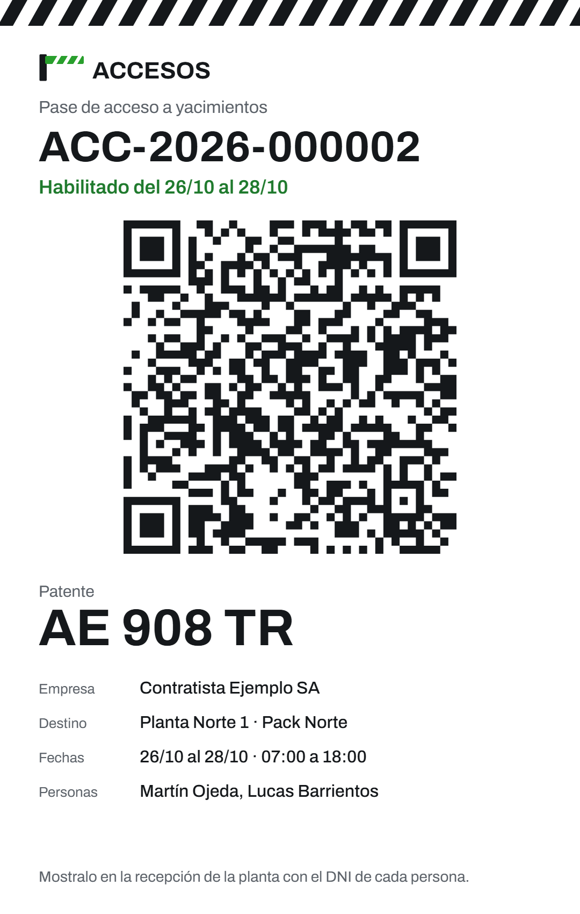
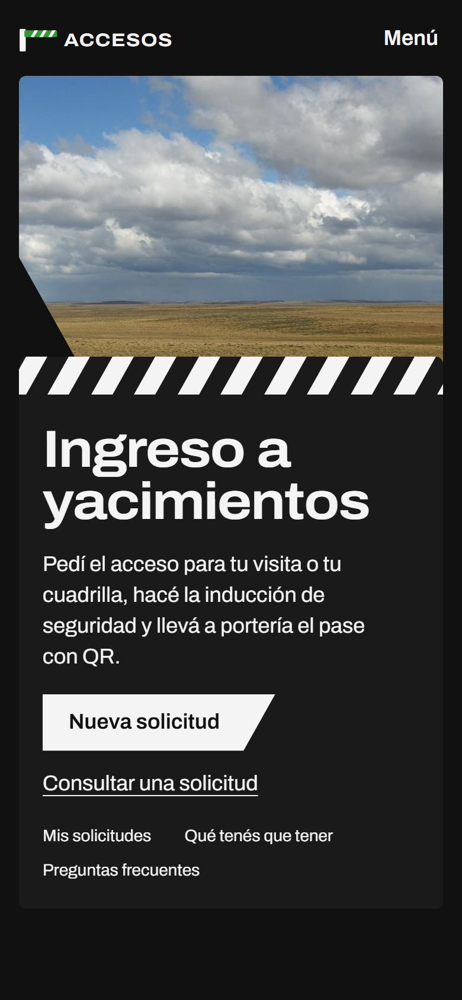

# Solicitud de accesos de visitas

Portal completo para que visitas y contratistas pidan acceso a yacimientos de petróleo y gas, y
para que la operadora lo gestione de punta a punta: desde la solicitud hasta el registro de
ingreso y egreso en la planta. Es un proyecto de ejemplo; la marca, los yacimientos y los datos son
ficticios.



## Capturas

| Asistente: elegir yacimiento y planta | Asistente: revisión antes de enviar |
| --- | --- |
|  |  |
| **Panel de HSE: documento observado** | **Solicitud aprobada, con sus dos firmas** |
|  |  |
| **Recepción en planta: QR escaneado** | **Personas en planta (evacuación)** |
|  |  |

| Pase en el celular, sin señal | Imagen del pase guardada | Inicio en el celular |
| --- | --- | --- |
|  |  |  |

Más en [`docs/capturas`](docs/capturas): inducción en video, versión impresa de personas en planta
y el expediente con cada ingreso y egreso.

## Qué resuelve

- **Solicitud en 7 pasos**: solicitante, destino (pack y planta), motivo y fechas, personas y
  vehículos, documentación (ART y nómina), inducción de seguridad en video que no se puede
  adelantar, y revisión. El borrador se guarda solo y valida con las mismas reglas que el servidor.
- **Dos firmas**: HSE revisa documentos e inducción (acepta u observa cada documento; el
  solicitante reemplaza lo observado) y el responsable de la planta autoriza. Nadie aprueba lo
  propio y cada autorizante ve solo sus plantas.
- **Pase con QR firmado**, en PDF adjunto al mail y como imagen, que se ve sin señal en el celular.
- **Recepción en planta**: lectura del QR con la cámara de una tablet, Habilitado / No habilitado,
  ingreso y egreso por persona, búsqueda por N°, DNI o patente.
- **Personas en planta ahora**, imprimible para una evacuación, y lista de quienes quedaron sin
  egreso al final del día.
- **Mails en cada etapa**, con cola en la base y reintentos (SMTP o Microsoft Graph).
- **Retención de datos personales** configurable: adjuntos y datos se borran N meses después de
  cerrada la solicitud; el historial queda sin datos personales.

## Cómo está hecho

| Capa | Tecnología |
| --- | --- |
| Front | Vue 3, Vite, Tailwind 4, GSAP, service worker propio, lector QR con BarcodeDetector o jsQR |
| Back | Node + Express 5, PostgreSQL, validaciones zod compartidas con el front |
| Seguridad | JWT en cookie httpOnly, bcrypt, bloqueo por intentos, CSRF por origen, rate limit, CSP, canal interno/externo (el panel no existe desde internet), uploads con magic bytes + antivirus del servidor |
| Calidad | 100+ tests (vitest + supertest) y recorridos de punta a punta en navegador real |

Monorepo con npm workspaces: `packages/shared` (validaciones y máquina de estados), `server`, `web`.
La regla de validación del QR está documentada en [`docs/validacion-qr.md`](docs/validacion-qr.md).

## Levantarlo en local

Requiere Node 22+.

```bash
npm install
npm run dev:db -w server               # PostgreSQL embebido (puerto 5433), crea server/.env
npm run migrate -w server && npm run seed -w server
npm run dev:api                        # API en 127.0.0.1:3100
VITE_CANAL=interno npm run dev:web     # front en http://localhost:5173 (simula la red interna)
```

Usuarios del panel:

```bash
node server/scripts/create-user.js --email hse@ejemplo.test --nombre "HSE" --roles hse --password "una-clave-larga"
node server/scripts/create-user.js --email aut@ejemplo.test --nombre "Autorizante" --roles autorizante --plantas norte-1 --password "una-clave-larga"
node server/scripts/create-user.js --email recepcion@ejemplo.test --nombre "Recepción" --roles porteria --plantas norte-1 --password "una-clave-larga"
```

Tests: `npm test`.

## Créditos

Fotos del Inicio: Wikimedia Commons y Flickr, con licencia y autor en el pie de la página.
